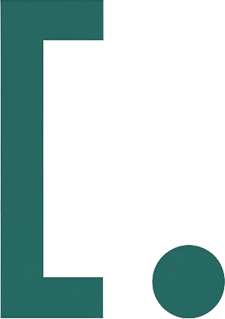

# Sankshep

*Sankshep* (संक्षेप) is Sanskrit for "the concise essence" — a summary that keeps the substance and
drops the excess.

**Maximum context, minimum tokens — [with the benchmarks to prove it](benchmarks.md).**

Sankshep is a proprietary [MCP](https://modelcontextprotocol.io) server, written in C#/.NET 10, that
gives MCP clients — VS Code Copilot Chat, Claude Code, Claude Desktop, Cursor — **token-minimized,
relevance-ranked codebase context**, plus a **persistent, per-repo memory** of facts and decisions.

Everything runs **locally**: embeddings via ONNX Runtime, vector search via sqlite-vec, **no code or
content leaves your machine** and there is **no telemetry by default**.

## Why it exists

An AI assistant is only as good as the context it's given — but whole files burn tokens and bury the
answer. Sankshep sends the model the *small, relevant slice* instead: it retrieves the chunks that
matter and AST-minimizes them (strips comments, collapses non-target method bodies), then reports how
many tokens it saved.

The full surface — twelve MCP primitives (seven tools, four prompts and one resource), each documented with
real captured I/O in the [tool reference](tool-reference.md):

- :material-scissors-cutting: **Read** — ranked, comment-stripped, body-collapsed context under a
  token budget, every line numbered by its source line so an answer can cite `path:N`, and `path:start-end`
  for exact lines ([`read`](tool-reference.md#read)).
- :material-magnify: **Find** — exact, regex and symbol search over the working tree with no index, plus
  semantic search over a local embedding index you build with `index` ([`find`](tool-reference.md#find)).
- :material-file-tree: **Outline** — the projects, packages, scripts, images and pipelines under a
  directory, then its declarations, each cited by line ([`outline`](tool-reference.md#outline)).
- :material-brain: **Remember** — a per-repo, branch-scoped fact store that survives across sessions and
  clients ([`remember` / `recall`](tool-reference.md#remember)).
- :material-file-document-check: **Decisions** — decision-tagged memory as `DECISIONS.md` text, for you
  to write where you want it ([`recall`](tool-reference.md#recall) with `format=markdown`).
- :material-counter: **Measure** — every tool and prompt call and the tokens it returned, with the
  compression claim kept apart, no dollar guesswork ([`report`](tool-reference.md#report)).
- :material-package-variant: **Compose** — a grounded one-shot prompt from minimized code + memory that
  names anything it could not include ([`implement`, the prompt composer](composer.md)).
- :material-account-group: **Agents** — `sankshep init` writes an Explorer, an Architect, an Implementer
  and a Reviewer for VS Code Copilot, Claude Code and Cursor ([Agents](agents.md)).

## Get started

- **[Quickstart](quickstart.md)** — install → connect → index → first grounded answer → see the savings, in ~5 minutes.
- **[Install](install.md)** — `dotnet tool install -g sankshep`, client configs, HTTP, and environment variables.
- **[Agents](agents.md)** — `sankshep init` sets up four agents and the `.mcp.json` registration in one command.
- **[Upgrading to 5.0.0](upgrading-5.0.md)** — every tool is renamed in 5.0.0, with no aliases; the mapping and what to change.
- **[Tool reference](tool-reference.md)** — every tool's arguments and a real captured request/response.
- **[How it works](how-it-works.md)** — the three-layer model, MCP, and where Sankshep fits.
- **[Deployment](deployment.md)** — Docker, Windows Service, systemd, Kubernetes, air-gap.
- **[Troubleshooting](troubleshooting.md)** · **[Security & privacy](security.md)** · **[Architecture](architecture.md)** — when something misbehaves, what stays local, and the engineering behind it.

!!! note "Proprietary, free to use"
    Sankshep is proprietary software, **free to install and use** (including commercially), on any number
    of machines you control. Two things the licence does not permit: hosting it as a service to third
    parties, and modifying it or building derivative works from it — a container image derived from the
    published one included. Its source is private and it does not accept external pull requests — but the
    tool itself stays a public, free-to-install package. The full `LICENSE` ships inside the NuGet package
    and at `/app/LICENSE` in the container image. See [Feedback](feedback.md) to reach the maintainer.
